<picture>
  <source media="(prefers-color-scheme: dark)" srcset="./assets/header-dark.svg">
  
</picture>

 

**AI & Full-Stack Engineer with LLM agents in production**: vision, voice and document extraction in an ERP used daily, and CRM agents serving about 500 users a month. Based in Manta, Ecuador; open to relocation or remote.

 

SELECTED WORK

<table>
  <tr><td nowrap><code>01</code></td><td nowrap><a href="https://github.com/DweskZ/EcuDataMCP"><b>EcuDataMCP</b></a></td><td>Open-source MCP server that connects AI assistants to Ecuador's official public data, queryable in natural language. Creator and co-maintainer; 22 releases.</td></tr>
  <tr><td nowrap><code>02</code></td><td nowrap><a href="https://github.com/StevSant/hackiaton_agent_ai_3.0"><b>Centinela IA</b></a></td><td>Fraud triage for insurance claims: rules, LightGBM + SHAP, pgvector similarity and a voice-enabled LangGraph agent. <b>1st place</b>, HackIAthon Viamatica 2026. Team project; I led product and integrated and validated the system end to end.</td></tr>
  <tr><td nowrap><code>03</code></td><td nowrap><b>Midas</b></td><td>Multi-agent market intelligence: a LangGraph supervisor with 6 specialist agents and pgvector RAG over live data. <b>3rd place</b>, ESPOL National Hackathon 2026. Team project; same role.</td></tr>
  <tr><td nowrap><code>04</code></td><td nowrap><b>MasCamarón</b></td><td>Harvest decision engine for shrimp farms: a bioeconomic model that recommends when to harvest, with a FastAPI API, CLI and web UI.</td></tr>
</table>

<a href="https://github.com/DweskZ?tab=repositories">all repositories →</a>

STACK

<table>
  <tr><td nowrap><b>AI & LLMs</b></td><td>LangGraph · RAG · embeddings · vision and tool-use · MCP · OpenAI and Claude APIs</td></tr>
  <tr><td nowrap><b>Machine Learning</b></td><td>LightGBM · Isolation Forest · SHAP · scikit-learn · pandas</td></tr>
  <tr><td nowrap><b>Backend & Data</b></td><td>Python · FastAPI · REST APIs · SQL · PostgreSQL · pgvector · Supabase</td></tr>
  <tr><td nowrap><b>Frontend & Mobile</b></td><td>TypeScript · Angular · Next.js · React Native</td></tr>
  <tr><td nowrap><b>Cloud & DevOps</b></td><td>Docker · AWS · Git · GitHub Actions (CI/CD) · automated testing</td></tr>
</table>

CONTACT

[Portfolio](https://luis-figueroa-portfolio.vercel.app/) · [LinkedIn](https://www.linkedin.com/in/lufid12/) · [lfdwesk@gmail.com](mailto:lfdwesk@gmail.com)

 

<picture>
  <source media="(prefers-color-scheme: dark)" srcset="./assets/footer-dark.svg">
  
</picture>
